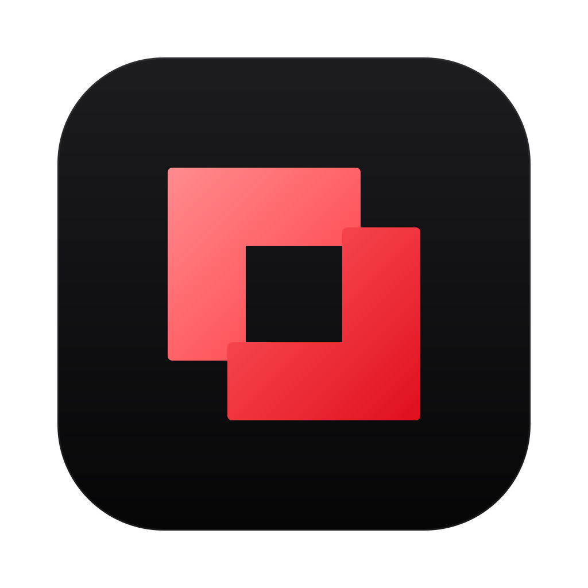

<p align="center">
  
</p>

<h1 align="center">Fragua</h1>

<p align="center">
  A native macOS development workspace written in Rust + GPUI.<br>
  Terminal, editor, Git, Claude Code, servers and focus tools in one fast window.
</p>

<p align="center">
  <a href="https://github.com/judare/fragua/releases/latest"><b>Download the .dmg (Apple Silicon)</b></a>
</p>


## The best parts

- **Native, GPU-rendered, no Electron.** Rust + GPUI at 120 fps. It opens instantly and stays responsive with dozens of tabs.
- **Built around Claude Code.** Claude terminals get a context ring, a model/effort switcher, session history (`/resume`) and a sessions board. Fragua acts as Claude's IDE (diffs, selection, open files), and you get an alert when Claude finishes.
- **An MCP server built in.** Claude can see your dev servers, run commands over SSH, drive your Brave browser (open, screenshot, eval JS, pick an element) and read or draft WhatsApp messages. Nothing is sent without your review.
- **Projects with many repos.** Open a folder and every Git repository inside is detected. Each project keeps its own terminals, files and servers, and opens in its own window.
- **A real editor.** Tree-sitter highlighting, LSP hover, multi-cursor (⌥-click, ⌘D, ⌃⌘G), ⌘-click links and paths, project search.
- **A VS Code-style Git UI.** Full-file diffs with word-level highlights, staging per change, blame, merge conflict helpers and a 90-day activity heat map.
- **GitHub from inside.** Actions panel (one row per workflow, filtered by branch), Tags panel that publishes releases.
- **Dev servers and SSH.** Run/stop dev servers per repo with live ports. Add SSH servers per project with an SFTP browser and SSH terminals.
- **Opens almost anything.** Office, PDF, PPTX, spreadsheets, CSV (table or edit), images with zoom/pan, video. Export Markdown to a branded PDF.
- **Smart terminal.** xterm mouse reporting, hover previews of paths and images, ⌘-click paths, search, scrollback restored after a restart. Paste an image and it goes straight to Claude.
- **Focus mode for real.** Projects can have opening hours (locked outside them, with emergency extensions). Websites can be blocked system-wide via `/etc/hosts` or just in Brave, on a schedule, and adult content is blanked.
- **WhatsApp inside.** Chats, voice notes, forwarding, notifications and an "unanswered" filter. Claude drafts the replies, you send them.
- **⌘Space launcher.** Apps, URLs, projects, files and project actions.
- **Small things.** TOTP 2FA codes from the Keychain, music/podcast/video player, light/dark theme, Claude usage meters (5 h / weekly).

## Screenshots

| | |
|---|---|
|  |  |
|  |  |

## Install

Download the latest `.dmg` from [Releases](https://github.com/judare/fragua/releases/latest), open it and drag **Fragua** to Applications. The build is not notarized, so the first time right-click the app and choose **Open**.

From source:

```sh
cargo run --release              # run it
./packaging/build-app.sh         # build and install Fragua.app into /Applications
```

State lives in `~/Library/Application Support/juan-terminal/` (the folder keeps its original name).

## Shortcuts

| | |
|---|---|
| ⌘, | Settings (`settings.toml`: project schedules, blocked websites) |
| ⌘O | Open folder as project (auto-detects Git repos) |
| ⌘⇧O | Add repository to current project |
| ⌘⇧N | New window |
| ⌘T / ⌘W | New / close terminal tab |
| ⌘⇧] ⌘⇧[ / ⌃Tab | Next / previous tab |
| ⌘C / ⌘V | Copy selection / paste |
| ⌘K | Clear terminal + scrollback |
| ⌘B | Toggle sidebar |
| ⌘= ⌘- ⌘0 | Font size |
| ⇧PgUp/PgDn, ⌘Home/End | Scroll |
| ⌘N | New untitled file (first save asks where; the extension sets the language) |
| ⌥-click | Add / remove a cursor |
| ⌥⌘↑ / ⌥⌘↓ | Add cursor above / below |
| ⌘D / ⌃⌘G | Select next / all occurrences (multi-cursor); Esc back to one cursor |

Terminal output (last 5,000 lines) is saved on quit / window close and shown again when the tabs are restored.

## Settings

`~/Library/Application Support/juan-terminal/settings.toml` (⌘, opens it; applied on save):

* `[projects.<id>] schedule = [{ days = [...], start = "HH:MM", end = "HH:MM" }]`: hours a project
  can be opened (Mac local time, or a fixed `utc_offset = "-05:00"`). Outside them it is locked in the
  sidebar and, if open, closed (files saved, 5-minute warning). Folders on disk are never touched.
* `blocked_websites = [...]`: blocked system-wide via a managed block in `/etc/hosts` (macOS asks
  for the admin password when the list changes). Additions apply at once; removals only after
  24 h. They are also blanked in Brave.
* Brave guard (DNS untouched; needs Brave › View › Developer › Allow JavaScript from Apple
  Events): `brave_blocked_websites` (e.g. YouTube) are always blank, `[[website_schedules]]`
  outside their hours, a project's `websites` while it is locked; `brave_no_video_websites`
  (e.g. x.com) lose their videos; any page with many adult keywords is blanked.
* Emergencies: opening a locked project offers "Open for 1 hour / 4 hours"; ⌘⇧P → "Keep Project
  Open 1 More Hour" extends the open one.

## Tests

```sh
cargo test --workspace
```

See [ARCHITECTURE.md](ARCHITECTURE.md), [DECISIONS.md](DECISIONS.md), [ROADMAP.md](ROADMAP.md), [PERFORMANCE.md](PERFORMANCE.md).
